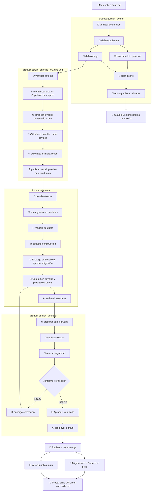

# De idea a producción con Claude · Plugins para PMs

Tres plugins de skills para Claude que llevan un producto digital desde el material de partida hasta una versión publicada, construyendo con vibe coding (Lovable, Supabase, GitHub y Vercel) y con el PM decidiendo en cada paso. Funcionan en cualquier proyecto: no llevan nada fijo de un caso concreto.

| Plugin | Versión | Para qué sirve |
| --- | --- | --- |
| `product-builder` | 0.5 | **Definir.** Escribe los documentos de producto en `docs/`: evidencias, problema, benchmark, MVP, diseño, fichas de feature, modelo de datos y encargo para Lovable. |
| `product-setup` | 0.4 | **Montar.** Supabase de desarrollo y de producción, Lovable en la rama `develop`, Vercel y la GitHub Action de migraciones. |
| `product-quality` | 0.2 | **Verificar.** Datos de prueba, pruebas con Playwright, revisión de seguridad, informe-puerta, corrección y pull request a `main`. |

## Instalación
1. Descarga los archivos `.plugin` de este repositorio.
2. En Claude (app de escritorio o Claude Code), instala cada plugin desde la sección de plugins o arrastrando el archivo.
3. Abre un chat nuevo para que se carguen las skills.
4. Crea una carpeta de trabajo con tu material en `material/` y pide «Analiza el material».

## Principios
- **El PM decide.** Ninguna skill cambia nada en una herramienta externa sin enseñar el plan y recibir tu «adelante» expreso.
- **La ficha de feature (mini PRD) es el hilo conductor.** De ella salen las tablas, el encargo a Lovable y las pruebas.
- **Se prueba contra la ficha, no contra el código.** Una feature solo es «Verificada» con evidencia por criterio de aceptación.
- **Seguridad desde la primera migración.** RLS en la misma migración que crea cada tabla; URL y clave pública de Supabase desde variables de entorno; la clave `service_role` nunca en el cliente ni en el repositorio.
- **Dos entornos.** `develop` usa el Supabase de desarrollo; `main` es producción y usa el suyo. A `main` solo se llega por pull request.

## El flujo
Leyenda: 🧑 manual del PM · 🤖 skill sin cambios externos · ⚙️ skill que ejecuta con «adelante» · 🔁 automático.

## Qué hace cada skill

### product-builder · definir
| Skill | Pídelo así | Produce | Tu papel |
| --- | --- | --- | --- |
| analizar-evidencias | «Analiza el material» | `docs/product/evidence-summary.md` | Aportar el material |
| definir-problema | «Formula y prioriza los problemas» | `docs/product/problem.md` | Aprobar |
| benchmark-inspiracion | «Haz un benchmark de inspiración» | `docs/product/benchmark.md` | Elegir qué inspira |
| definir-mvp | «Define el MVP» | `docs/product/mvp.md`, `docs/backlog.md` | Aprobar el corte |
| brief-diseno | «Prepara el brief de diseño» | `docs/design/design-brief.md` | Elegir referencias |
| encargo-diseno | «Encargo del sistema de diseño» · «Encargo de pantallas de F03» | `docs/design/encargo-*.md` | Lanzarlo en Claude Design |
| detallar-feature | «Detalla F03» | `docs/features/F03-*.md` | Cerrar dudas y aprobar |
| modelo-de-datos | «Define el modelo de datos» | `docs/tech/data-model.md` | Aprobar |
| paquete-construccion | «Prepara el paquete para Lovable» | Commit en `develop` y `docs/features/F03-encargo.md` | Aprobar y lanzar el encargo |
| revisar-coherencia | «Revisa la coherencia» | Lista de incoherencias | Decidir |
| estado-del-producto | «¿Dónde estamos?» | Estado y siguientes pasos | — |

### product-setup · montar
| Skill | Pídelo así | Qué hace | Tu papel |
| --- | --- | --- | --- |
| verificar-entorno | «Comprueba el entorno» | Cuentas y conectores | Conectar lo que falte |
| montar-base-datos | «Monta la base de datos» | Supabase dev y prod vacíos y mapa de datos | Ajustes de Authentication |
| arrancar-lovable | «Arranca Lovable» | Lovable conectado a dev; bloquea si hay claves en el código | Crear el proyecto y conectar GitHub con `develop` |
| automatizar-migraciones | «Automatiza las migraciones» | GitHub Action que aplica migraciones a prod al fusionar en `main` | Guardar los secretos en GitHub |
| auditar-base-datos | «Audita la base de datos» | Compara lo creado con el modelo | Aprobar correcciones |
| publicar-vercel | «Prepara la publicación» | Variables por entorno, `main` protegida, bypass para pruebas, dominio | Registro DNS y guardar el bypass |

### product-quality · verificar
| Skill | Pídelo así | Qué hace | Tu papel |
| --- | --- | --- | --- |
| preparar-datos-prueba | «Prepara los datos de prueba» | Dos usuarios por rol y datos por criterio, solo en dev | Dar el «adelante» |
| verificar-feature | «Verifica F03» | Prueba los criterios contra la preview: modo exploratorio (MCP de Playwright, en directo) o modo repo (tests repetibles) | Elegir modo y resolver fichas ambiguas |
| revisar-seguridad | «Revisa la seguridad» | Secretos, variables, RLS, aislamiento entre roles, lógica en servidor | Aceptar o no riesgos |
| informe-verificacion | «¿Está lista F03?» | Veredicto VERDE o ROJO con evidencias | Aprobar |
| encargo-correccion | «Prepara la corrección» | Encargo de arreglo a Lovable, enviado con tu «adelante» | Aprobar el envío |
| promover-a-main | «Pasa a producción» | Pull request de `develop` a `main` con informes | Hacer el merge |

## Caso práctico y prompt maestro

- `caduca-material-del-caso.zip` (v1.3): caso CADUCA para practicar el flujo completo. Al descomprimirlo, la carpeta `CADUCA/` trae `PROYECTO.md`, la plantilla `[template]-PROYECTO.md`, el material de partida en `material/` y `docs/` vacío.
- `PROMPT_MAESTRO.md` (v1.1): instrucciones para el Proyecto de Claude, válidas para cualquier proyecto. Se copian en las instrucciones del Proyecto; no se dejan en la carpeta vinculada. Lo propio de cada proyecto va en `PROYECTO.md`, que indica dónde está el material de partida.

Para trabajar el caso, vincula al Proyecto una carpeta con `PROYECTO.md`, `material/` y `docs/`, y empieza con «Analiza el material».

## Requisitos
- Cuentas: Claude, Lovable, Supabase (dos proyectos: el plan gratuito permite dos activos por persona, sumando todas sus organizaciones; los pausados no cuentan), GitHub y Vercel. PostHog opcional.
- Conectores de Claude: Supabase, GitHub, Vercel y Lovable. **Conecta GitHub y Vercel con permiso de escritura**: con solo lectura las skills fallan a mitad (403).
- En GitHub, autoriza la app de Vercel con acceso a los repositorios que cree Lovable (o a todos).
- Para `product-quality`, Node.js y una de estas dos opciones:
  - **Modo exploratorio (para aprender):** el MCP de Playwright en Claude Desktop o Claude Code. Claude prueba en un navegador que ves en directo. Es más visual, pero no deja tests repetibles.
  - **Modo repo (para un proyecto real):** Claude Code con Playwright en el proyecto (`npm i -D @playwright/test` y `npx playwright install chromium`). Deja un test por criterio en `tests/e2e/` que se repite en cada corrección. Es la configuración precisa y la recomendada antes de pasar a producción.
- En Lovable, la rama de trabajo `develop` (GitHub branch switching).

## Dónde vive cada cosa
- **En el repositorio del producto:** `docs/`, `AGENTS.md`, `supabase/migrations/`, `tests/`, `playwright.config.ts`, el workflow de migraciones y `.env.example` solo con nombres.
- **Nunca en el repositorio:** `.env.test.local` (contraseñas de prueba y bypass de Vercel, en local), los secretos de GitHub (`SUPABASE_PROD_DB_URL` con la contraseña de producción y `SUPABASE_PROD_PROJECT_REF`) y `.security-audit/`.

## Aviso
Es una primera versión pensada para aprender el proceso. Un producto real necesita más iteración, revisión humana del código y una auditoría de seguridad completa antes de manejar datos reales.

## Licencia
[MIT](LICENSE): puedes usar, copiar, adaptar y compartir estos plugins, también con fines comerciales, manteniendo el aviso de autoría.

Autor: Oscar Subirats · [oscarsubirats.me](https://oscarsubirats.me)
